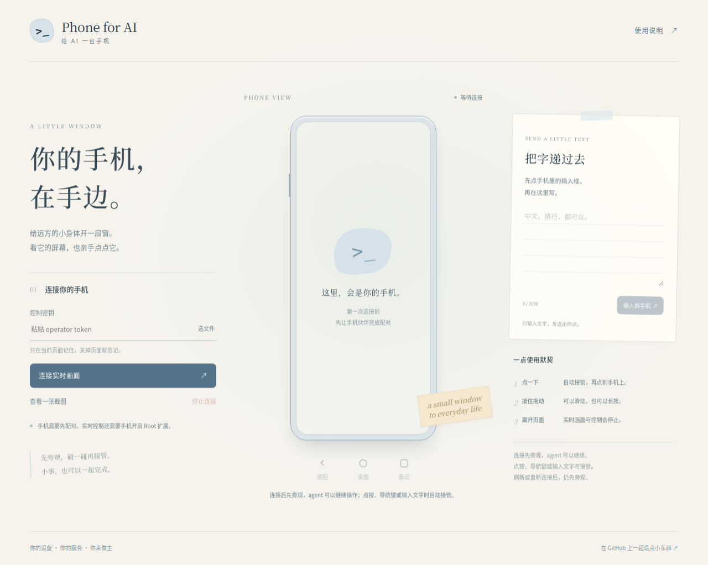

# 人也能用的网页控制台

部署完成后，在自己的 HTTPS 服务根地址打开网页，例如 `https://phone.example.com/`。

1. 选择本机的 `operator.token` 文件，或粘贴密钥。
2. 手机已配对、无障碍与 Root 扩展开启后，点“连接实时画面”。
3. 第一帧画面出现后，状态为“正在旁观”，agent 可以继续操作。点按、拖动、长按手机画面，或使用底部返回、桌面、最近任务，才会接管；手机完成交接后显示“已接管”。
4. 输入文字时，先点手机中的目标输入框，再在侧边写字并点“输入到手机”。查看手机回显后，再由你点发送。
5. 结束时点“停止连接”。切到其他标签页、离开或关闭页面也会停止传屏和控制；回来后可以重新连接。

实时模式由 scrcpy 4.1 提供手机端 H.264 视频与触控，服务端只做鉴权转发，浏览器通过 WebCodecs 解码。它需要手机 Root，以及支持 H.264 WebCodecs 的浏览器和安全上下文（HTTPS，或同机 localhost）。0.1.2 起由 Root 启动的 scrcpy 主动连接手机伙伴，不再要求 Root 方案放行“普通 App 连接 Root 进程”。首版没有录屏保存功能。

还没开启 Root 时，可以先点“查看一张截图”。单张截图依赖无障碍截图能力，不提供连续控制；不会偷偷切成轮询视频。

## 与 agent 怎么配合

v0.2.0 的实时连接默认旁观，不打断 agent。打开或重新连接、恢复视频、展开文字栏和在本地打字都不会接管；实际触摸画面、按导航键或发送非空文字才接管。旁观不唤醒、不保亮，原本熄屏的手机会继续熄屏。

接管时先暂停新的修改类手机指令，等待手机结束或取消旧的 UI 操作，再按原顺序发送你的第一次输入；状态变成“已接管”才表示交接完成。此后 agent 的点击、唤醒、输入、应用启动、shell 和文件写入等指令会被拒绝，状态、已有回执及纯读取仍可查询。已运行的通用 shell 和已发生的副作用不能被接管撤销。

结束网页连接后，agent 重新截图接着做；下次连接重新从旁观开始。同一服务一次只连接一个观看者。v0.1.2 及更早版本仍是连接即独占；请按[升级步骤](setup.md#升级到-v020)同时更新服务端和手机伙伴。

浏览器的密钥只保存在当前页面内存中，不写入 URL、localStorage 或永久 Cookie；关闭页面后需要重新提供。服务器静态页面不含密钥，真正的状态、图片和控制接口都要求鉴权。

网页给出“文字已递给手机”只表示控制消息已发送，目标输入框是否接受、是否需要粘贴，以手机实际画面为准。

## 常见问题

- **点连接却没有画面，也没出现“手机连上了”**：看手机伙伴是否在线和网络；另外检查反向代理是否支持 WebSocket Upgrade。
- **显示“手机连上了，等第一帧画面…”之后报错**：按网页给出的原因处理。
  - “手机伙伴没拿到 Root”：在 Root 管理器里给 AI 手机伙伴**永久**授权。授权是限时或“仅此一次”时，开始投屏会在手机上弹授权框，远程看不到，超时就被拒了。
  - “投屏组件（scrcpy）没能启动”或“10 秒内没连上手机伙伴”：重新连接一次；反复出现时，在手机的 Root 终端运行 `logcat -d -s PhoneForAI scrcpy`，手机伙伴和 scrcpy 都会把原因写在这里。
  - “投屏中途出错了”：画面刚连上或传到一半断了。先重新连接；反复出现时同样看 `logcat -d -s PhoneForAI scrcpy`。
- **点了“桌面”或切到别的 App 后画面断开**：多半是手机伙伴退到后台后被系统冻结了。按[安装说明](setup.md#熄屏待命与-coloros-后台设置)开启它的无障碍服务和后台权限（ColorOS 是“允许完全后台行为”）；我们在没开这些权限的测试包上实际碰到过。
- **0.1.1 及更早版本先显示“等第一帧画面…”，约 10 秒后报“手机没能启动投屏”**：旧版由手机伙伴去连接 Root 启动的 scrcpy，下面这些 Root 方案的 SELinux 规则不放行：Magisk 23.0–26.1，KernelSU v3.2.3、SukiSU Ultra v4.1.3、KernelSU Next v3.3.0 之前的版本（看内核一侧），以及 APatch（按源码推断）。旧版 Magisk 还不记录这类拒绝，`logcat | grep avc` 查不到。升级到 0.1.2 即可。暂时不能升级的 Magisk 用户，可以用 `magiskpolicy --live "allow untrusted_app magisk unix_stream_socket connectto"` 补上新版 Magisk 默认自带的这条规则；重启后失效，需要时写进开机脚本。
- **浏览器不支持解码**：使用支持 WebCodecs/H.264 的新版本浏览器，先用单张截图确认服务链路。
- **页面回来后是暂停**：这是停止控制后的状态，手动重新连接即可。
- **MCP 提示 phone_stream_in_use**：有人已通过网页接管，等网页停止连接后再继续；只旁观时不会拦截。仍用旧版本时，观看本身也会独占。
- **提示需要更新服务端或手机伙伴**：按[升级步骤](setup.md#升级到-v020)把服务端和 APK 一起升到 v0.2.0，再刷新网页；旧组件不会被当成支持旁观。
- **接管超时或无法交接**：当前自动操作还没退出或手机未能唤醒，连接会结束；稍后重新连接并操作，失败的点击不会自动重放。
- **画面尺寸/方向变化**：控制台会暂停旧触控，等新画面解码完成再接受操作；不要缓存旋转前的坐标。

源码在 `web/`；协议见 [protocol.md](protocol.md)，验证情况见 [validation.md](validation.md)。
